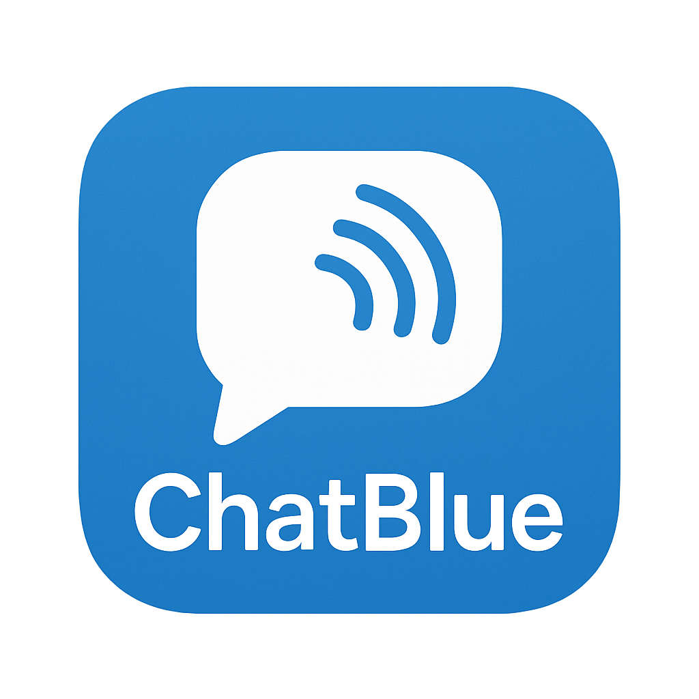
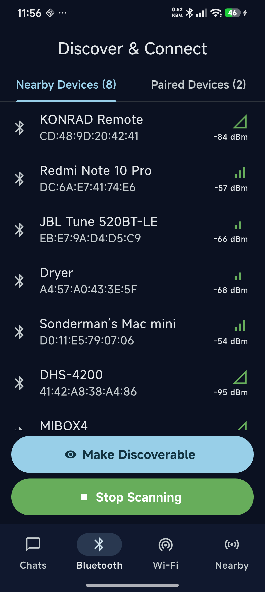
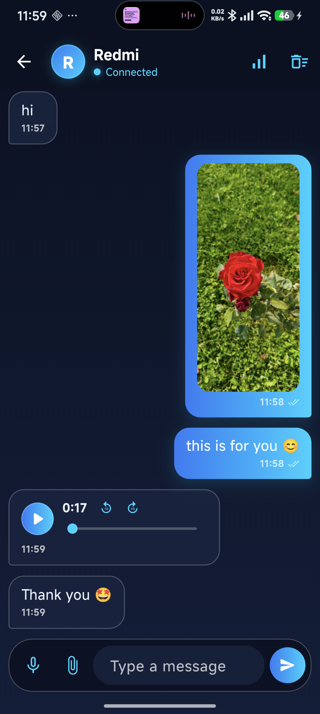

## ChatBlue



<table>
  <tr>
    <td></td>
    <td></td>
  </tr>
</table>

A fully offline, peer-to-peer chat application with **three transport channels**: Bluetooth Classic (RFCOMM), Wi-Fi Direct (P2P), and Google Nearby Connections. It aims to facilitate short-range, device-to-device communication, particularly in disaster scenarios like earthquakes, where the internet and network infrastructure are unavailable.

> Note: This repository targets Android. All three transports are implemented natively in Kotlin and exposed via Platform Channels; iOS support is not configured in this branch.

### Purpose
- Enable peer-to-peer messaging without internet access or network infrastructure — over three independent radio channels (Bluetooth Classic, Wi-Fi Direct, Nearby Connections).
- Designed for emergency scenarios (e.g., earthquakes) when connectivity is unavailable.
- Also useful for short-range communication when you intentionally stay offline.

TR — Amaç: Bu uygulamanın temel amacı, internet ve yerel haberleşme ağlarının mevcut olmadığı özellikle deprem felaketinin meydana geldiği durumlarda insanların haberleşebilmesini sağlamaktır. Böyle felaketler olmasa bile internet erişiminin olmadığı durumlarda kısa mesafelerde iletişim kurabilmeyi hedefler.

### Features
- Offline chat over three transports; the Connect button offers a per-chat **transport picker** (Bluetooth / Wi-Fi Direct / Nearby)
- Device discovery, connect/disconnect flow with a two-stage accept handshake, paired-devices support
- Text, image, voice, file (up to 20 MB) and location messages, with transfer-progress bubbles
- Delivery ticks (sent → delivered), confirmed by the peer device
- History sync on every (re)connection — SHA-256 manifests mean only genuinely missing messages travel; large media downloads on tap
- Paged chat history (newest 20 messages, then +5 per scroll step) with day separators
- Chat nicknames and last-message previews on the home list
- Connection-quality panel (link state, connected-for uptime, live traffic, signal / bandwidth quality)
- Local persistence of chat sessions, messages and settings (drift / SQLite)
- Modern navy/cyan Flutter UI with light & dark themes
- English + Turkish UI (gen-l10n; first launch follows the device language)

### How It Works
- Each transport is a custom Android native implementation in Kotlin (`BluetoothClassicManager`, `WifiDirectManager`, `NearbyManager`) exposed to Flutter via Platform Channels.
- Messages travel as a framed binary protocol (type flag + length); the two devices keep their copies in sync with a manifest-based history exchange on every (re)connection.
- No server, no internet, no cloud — everything is local to the devices.

### Screens at a Glance
- Home: past chat sessions (last-message preview + transport badge) with bottom navigation — Chats / Bluetooth / Wi-Fi / Nearby; long-press a row for nickname and delete actions
- Scan screens: discover and connect over Bluetooth Classic, Wi-Fi Direct or Nearby; each surfaces its own precondition panels (permissions, location, Bluetooth/Wi-Fi off, Play Services)
- Chat: text/image/voice/file/location bubbles, transfer progress and delivery ticks, a history-sync banner, a link-quality panel and the transport picker when offline

### Requirements
- Flutter 3.47+ (Dart 3.13+); Android SDK platform 37 for building
- Two Android devices for real testing, with Bluetooth and Wi-Fi Direct hardware
- Google Play Services on both devices for the Nearby Connections transport
- Android Studio (or VS Code). Emulators can render the UI but cannot exercise the radio transports — use physical devices.

### Android Build Targets
- compileSdk: 37
- targetSdk: 37
- minSdk: 24
- Java/Kotlin: 17
- AGP 9.4.1 · Gradle 9.6.0 · Kotlin 2.4.20

### Permissions
Depending on the Android version and the transport in use, the app may request:
- Bluetooth: BLUETOOTH / BLUETOOTH_ADMIN (Android 11 and below) or BLUETOOTH_SCAN / BLUETOOTH_CONNECT / BLUETOOTH_ADVERTISE (Android 12+)
- Location (ACCESS_FINE_LOCATION / ACCESS_COARSE_LOCATION): required by the platform for device discovery; Nearby Connections also requires location services to be on
- NEARBY_WIFI_DEVICES (Android 13+): Wi-Fi Direct and Nearby
- Microphone (RECORD_AUDIO): voice messages
- READ_MEDIA_IMAGES / storage (older versions): saving received images to the gallery
- No install-packages permission is used: APKs received over chat are saved to the Downloads folder and installed from the system file manager

### Getting Started
```bash
git clone https://github.com/Sonderman/ChatBlue.git
cd ChatBlue
flutter pub get
# Connect an Android device (physical device recommended for the radio transports), then:
flutter run -d <your-android-device-id>
```

Once running:
1) Open a transport tab (Bluetooth / Wi-Fi / Nearby), enable the required radios, and clear the permission panels on both devices.
2) Discover a nearby device and connect — the receiving side accepts via the connection-request card (Bluetooth pairing may be required first).
3) Chat: send text, or attach images / voice / files / your location from the composer. Transfer progress and delivery ticks appear on the bubbles.

Release APK:
```bash
flutter build apk --release                  # fat APK (all ABIs)
flutter build apk --release --split-per-abi  # smaller per-ABI APKs
```
> Signing: release builds sign with the upload keystore configured in `android/key.properties` when present; machines without it fall back to the debug key for local development — never distribute a debug-signed build. Keep your keystore backed up.

### Architecture & Tech Stack
- Flutter with Riverpod 3 state management (`ChatController` powers all three transports)
- drift (SQLite) for local storage and offline persistence
- gen-l10n translations (English / Turkish)
- Android native Kotlin implementations bridged via Platform Channels: Bluetooth Classic (RFCOMM), Wi-Fi Direct (TCP over P2P), Nearby Connections (BYTES payloads)
- Data flow: Manager (Kotlin) → PlatformChannel → Service → Transport notifier (Riverpod) → ChatTransportBinding → ChatController → Screen

For a deeper technical overview, see: `project_overview.md`.

### Limitations and Safety Notes
- Short-range only: the feasible distance depends on the transport (Bluetooth Classic is line-of-sight workable to ~10 m; Wi-Fi Direct and Nearby Connections can reach considerably further in open areas) and on the environment.
- Wi-Fi Direct support varies by device and OEM firmware; the Nearby transport requires Google Play Services on both devices.
- Not a replacement for emergency services. Do not rely on the app as the sole communication method in life-threatening situations.
- Messages are not end-to-end encrypted in this branch. Do not share sensitive information.
- Android only in this branch; iOS configuration was removed and would need re-setup.

### Privacy
- The app does not use the internet, any server or any cloud service. The Nearby Connections transport runs locally through Google Play Services on the two devices.
- Messages, sessions and settings are stored locally on the device (SQLite via drift); received media is saved to the app's private documents directory.

### Contributing
Contributions are welcome! Please open an issue to discuss significant changes before submitting a PR. Make sure to run formatting and address lints.

### License
This project is available under the license found in `LICENSE`.

### Acknowledgements
- Flutter team and ecosystem packages: Riverpod, drift, record, just_audio, file_picker, geolocator, image picker/compress, permission handler, etc.
- Google Nearby Connections (`play-services-nearby`)
